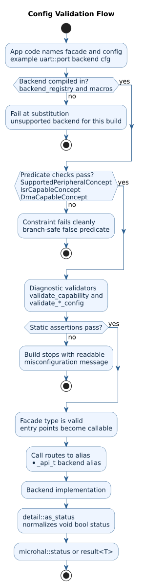
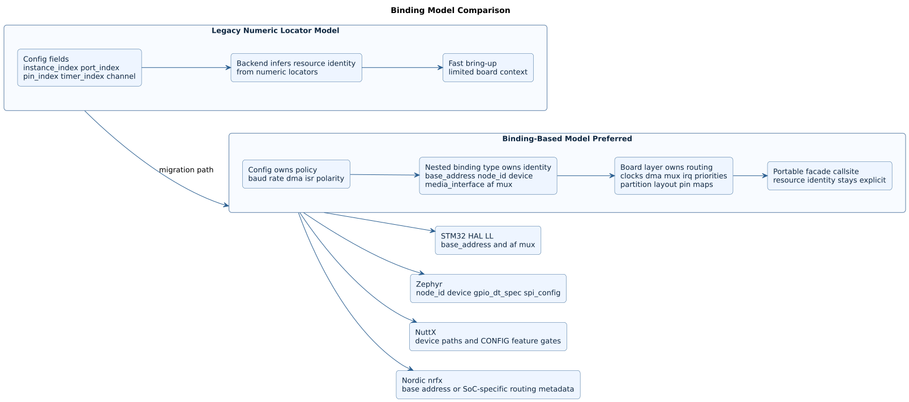
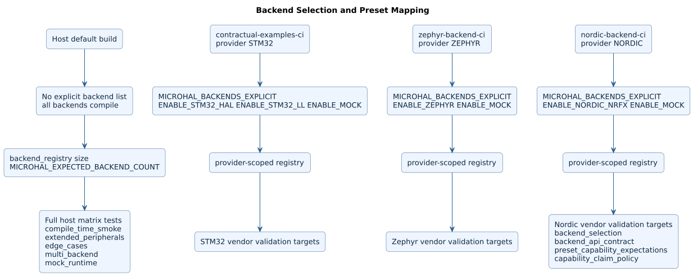
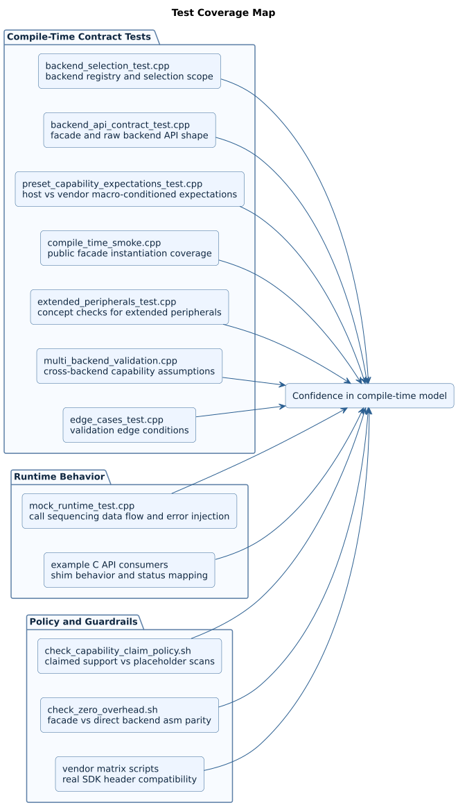
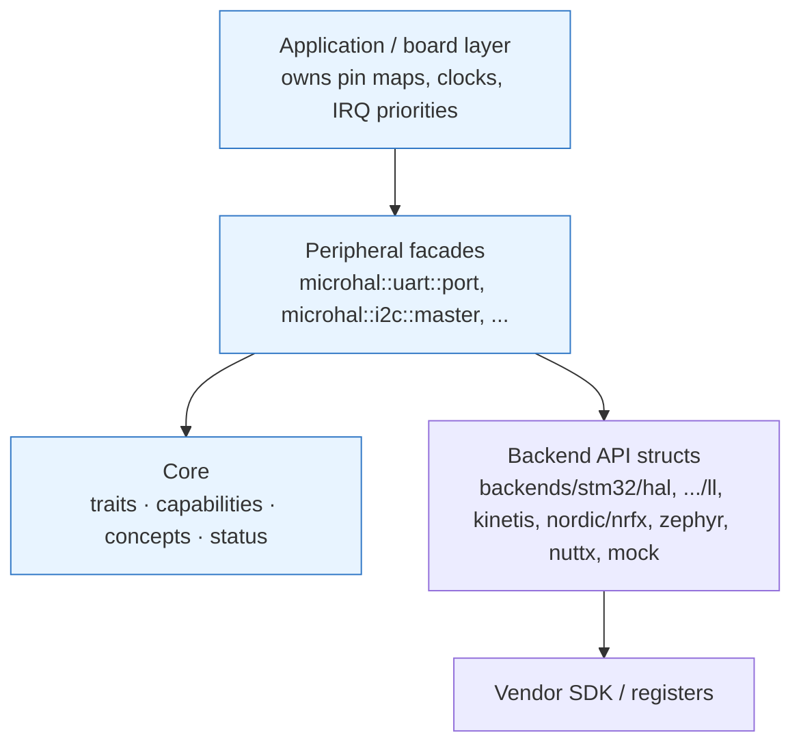
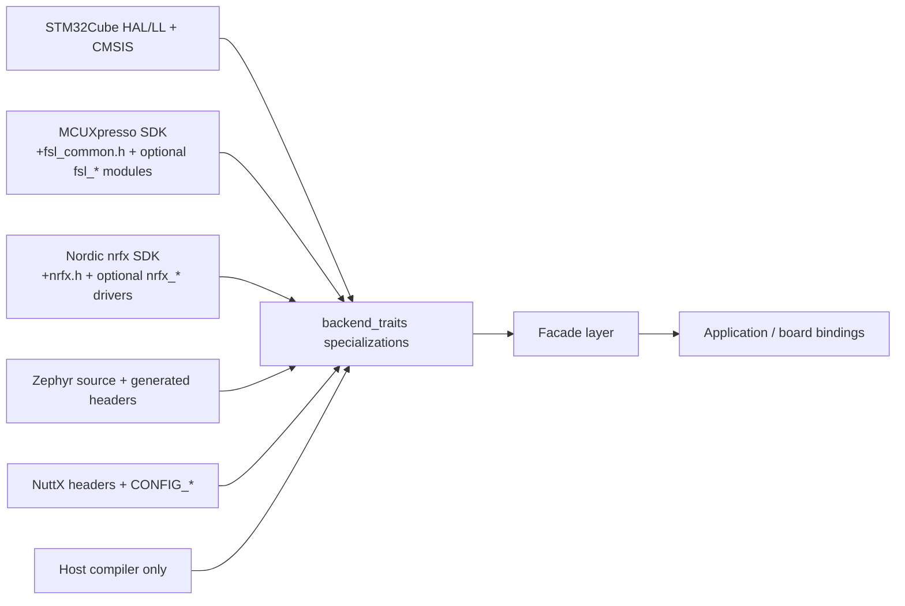
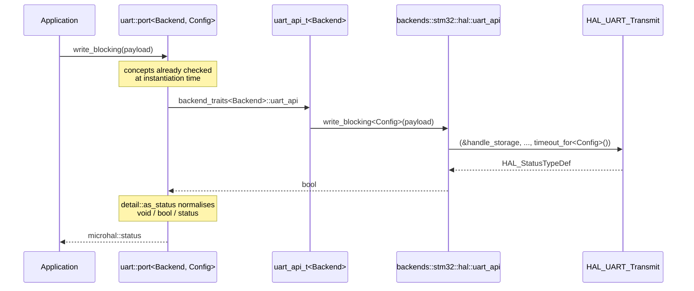
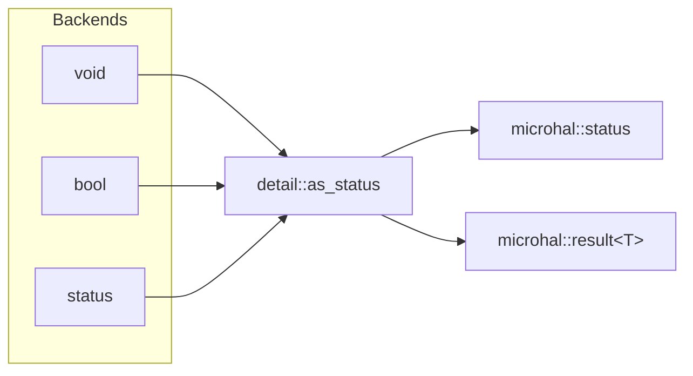

# microHAL Architecture

## Goals

- C++20-only, header-first microHAL for deterministic Cortex-M style targets.
- No exceptions, RTTI, dynamic allocation, virtual dispatch, or runtime backend selection.
- Compile-time backend capability validation with clear diagnostics.
- Backend-facing APIs structured to map directly onto STM32Cube HAL, STM32Cube LL, MCU Espresso, Zephyr, and future vendor layers.

## Diagram Set

PlantUML source files live in [docs/diagrams/README.md](diagrams/README.md).

- [Configuration validation flow](diagrams/generated/config_validation_flow.svg)
- [Binding model comparison](diagrams/generated/binding_model_comparison.svg)
- [Backend selection and preset map](diagrams/generated/backend_selection_preset_map.svg)
- [Test coverage map](diagrams/generated/test_coverage_map.svg)









## Layering



Everything above the backend layer is free of vendor types. The backend API structs are the only
place allowed to name an SDK symbol.

## Backend SDK Contract

Backend portability in microHAL is intentionally explicit: each backend compiles only when its
environment contract is present, and each board provides concrete resource bindings.



See [backend SDK requirements](backend_sdk_requirements.md) for the exact per-backend include,
definition, and board-binding requirements.

## Directory Layout

```text
microHAL/
  include/
    microhal/
      core/
        backend_config.hpp   # which backends are compiled in
        backend_selector.hpp # per-peripheral API aliases, kind -> tag mapping
        capabilities.hpp     # backend registry, capability_for<Backend, Peripheral>()
        concepts.hpp         # predicate layer + diagnostic layer
        status.hpp           # status / result<T> error vocabulary
        traits.hpp           # tags, enums, capability structs, backend_traits primary template
      backends/
        stm32/hal/traits.hpp
        stm32/ll/traits.hpp
        kinetis/espresso/traits.hpp
        nordic/nrfx/traits.hpp
        zephyr/traits.hpp
        nuttx/traits.hpp
        mock/traits.hpp      # host recording backend used by the runtime tests
      adc/adc.hpp
      can/can.hpp
      crc/crc.hpp
      dac/dac.hpp
      dma/dma.hpp
      ethernet/ethernet.hpp
      flash/flash.hpp
      gpio/gpio.hpp
      i2c/i2c.hpp
      i2s/i2s.hpp
      pwm/pwm.hpp
      qspi/qspi.hpp
      rcc/rcc.hpp
      rtc/rtc.hpp
      sd/sd.hpp
      spi/spi.hpp
      timers/timer.hpp
      uart/
        uart.hpp
        uart_autobaud.hpp
      usb/usb.hpp
      watchdog/watchdog.hpp
  cmake/
  tests/
  examples/
  docs/
```

## Core Model

- `backend_traits<BackendTag>` is the only backend registration point. A specialization publishes
  peripheral API type aliases (`uart_api`, `i2c_api`, ...) and one `consteval` capability accessor
  per peripheral (`uart_capability()`, `i2c_capability()`, ...).
- `backend_registry` is a `constexpr` array of `backend_descriptor` values for the backends compiled
  into the current translation unit. Its size therefore depends on `MICROHAL_BACKENDS`.
- `capability_for<Backend, Peripheral>()` is the single enum-to-accessor mapping. It returns the
  `base_capability` subset shared by every peripheral; peripheral-specific fields stay reachable via
  the typed `backend_traits<B>::x_capability()` accessors.
- Per-peripheral aliases `uart_api_t<B>`, `i2c_api_t<B>`, ... resolve a backend's API struct. Because
  an alias template is only instantiated on use, a backend may implement a subset of the twenty
  peripherals. `backend_dispatch_table<B>` still exists for compatibility but is deprecated: naming
  it forces the backend to define all twenty.
- Public peripheral facades are constrained by concepts and contain only `static inline` entry
  points. They hold no state.
- Capability failures terminate during template substitution through `consteval` validators.

### Tag dispatch, end to end



All of the indirection above is resolved at compile time; the generated code is a direct call.

## Error Reporting

microHAL is compiled with `-fno-exceptions`, so every fallible operation reports through
`microhal::status`, and value-returning operations through `microhal::result<T>`.



Backends were deliberately left free to return `void`, `bool`, or `status`: normalising at the
facade avoids rewriting five backends times twenty peripherals, and the adapter compiles away.

Facade entry points are `[[nodiscard]]`, so ignoring a failure is a warning (an error under the
vendor-validation build, which uses `-Werror`). Operations that cannot fail — `gpio::pin::set()`,
`gpio::pin::clear()` — still return `void`, and pure queries such as `timer::counter()` return their
value directly rather than a `status`.

## Concepts: predicate layer versus diagnostic layer

Two distinct jobs are kept separate, because a concept that hard-errors cannot be used to make a
decision:

- **Predicate layer** — `peripheral_available<B, P>()`, `peripheral_isr_available<B, P>()`,
  `peripheral_dma_available<B, P>()`, and the concepts `SupportedPeripheralConcept`,
  `IsrCapableConcept`, `DmaCapableConcept`. These evaluate to `false` for an unsupported
  combination and are safe inside `if constexpr` and `requires` clauses.
- **Diagnostic layer** — `validate_capability<B, P>()` and the `validate_*_config<B, C>()` family.
  These `static_assert` with a readable message and are meant to be called where a failure should
  stop the build.

Note that the per-peripheral configuration concepts (`UartConcept`, `I2cMasterConcept`, and so on)
are still built on the diagnostic `validate_*_config` functions. They report a precise message on
misconfiguration, but they hard-error rather than evaluating to `false`, so they must not be used
to branch on.

## Board Binding Layer

- Resource binding is a first-class integration concern across all backends, not just Zephyr.
- Applications are expected to own a board directory outside the microHAL library tree that names concrete resources such as `status_led`, `console_uart`, `sensor_i2c`, `motor_pwm`, and `log_flash`.
- Public configs may continue to use legacy numeric locators such as `instance_index`, `port_index`, `pin_index`, `timer_index`, and `channel`, but new integrations should prefer a nested `binding` type.
- The `binding` type carries backend-specific resource identity while the config keeps transport and policy choices such as baud rate, transfer mode, polarity, IRQ use, DMA intent, or sample rate.
- The currently implemented Zephyr convention is: GPIO bindings expose `binding::spec` as a `gpio_dt_spec`, device-backed peripherals expose `binding::device` (resolved with `DEVICE_DT_GET()` in board code), and SPI bindings additionally expose `binding::spi_config`.
- The currently implemented STM32 and Kinetis convention is: register-backed peripherals expose `binding::base_address`, while GPIO bindings expose `binding::port_index`, `binding::pin_index`, and backend-specific routing data such as `binding::alternate_function` or `binding::mux`.
- For Ethernet and SD on STM32 HAL, prefer `microhal::ethernet::bound_mac_config<Binding, ...>` and `microhal::sd::bound_host_config<Binding, ...>` so board code can supply the extra hardware identity those peripherals need.
- STM32 Ethernet bindings may expose `binding::base_address`, `binding::media_interface`, optional `binding::mac_address`, and optional RX pool sizing via `binding::rx_buffer_size` and `binding::rx_buffer_count`.
- STM32 SD bindings may expose `binding::base_address` plus optional startup tuning such as `binding::clock_divider` and `binding::hardware_flow_control` when the vendor HAL needs board-specific values.
- Traditional vendor HAL bindings can also carry clock gates, DMA mux selections, timer channels, and static flash layout alongside those identity fields.
- STM32 GPIO interrupt bindings must provide `binding::enable_interrupt<Handler>()`. microHAL configures the EXTI edge from `PinConfig::interrupt_trigger`; the board hook owns NVIC setup and the interrupt-vector dispatch to `Handler`.
- STM32 DAC configs resolve a nested binding's `base_address` first, then a legacy `instance_index` (`1` maps to `DAC1`, and so on). HAL state is isolated per configuration so two board DAC bindings cannot alias a shared handle.
- Peripheral clocks, pin muxing, DMA/DMAMUX routing, cache policy, and IRQ priorities remain explicit board work. The generic facade does not infer those routes from an instance number because the mapping is MCU-, package-, and board-specific.
- Backends should prefer `Config::binding` when present and treat raw numeric locators as a compatibility path for generic examples and simple bring-up.

```cpp
namespace app::board
{

struct console_uart_binding final
{
  static constexpr const struct device* device{DEVICE_DT_GET(DT_CHOSEN(zephyr_console))};
};

struct console_uart_cfg final
{
  using binding = console_uart_binding;

  static constexpr std::uint32_t baud_rate{115200U};
  static constexpr microhal::uart_parity parity{microhal::uart_parity::none};
  static constexpr microhal::uart_stop_bits stop_bits{microhal::uart_stop_bits::one};
  static constexpr bool enable_dma{false};
  static constexpr bool enable_interrupts{true};
  static constexpr bool require_fifo{false};
  static constexpr bool require_lpuart{false};
};

} // namespace app::board
```

## Capability Matrix Representation

- Each peripheral has its own capability struct (`gpio_capability`, `uart_capability`,
  `adc_capability`, ...). All of them begin with the same seven fields as `base_capability`
  (`supported`, `blocking`, `non_blocking`, `isr`, `dma`, `instance_count`, `max_frequency_hz`) and
  then add peripheral-specific fields such as `fifo_depth`, `resolution_bits`, or `erase_bytes`.
- A backend specialization publishes one `static consteval x_capability()` accessor per peripheral.
  There is no `capability_table` member and no per-backend `capability_for` member.
- Generic code reaches capabilities through the free functions in `core/capabilities.hpp`:
  `capability_for<Backend, Peripheral>()`, `peripheral_supported<Backend, Peripheral>()`,
  `peripheral_supports_isr<...>()`, and `peripheral_supports_dma<...>()`.
- `to_base_capability()` projects any typed capability struct onto the shared subset, which is what
  lets the enum-to-accessor mapping live in exactly one place.

## Generic Autobaud

- The autobaud layer is fully optional and selected at compile time.
- `autobaud_config` names the GPIO sense pin, timer resource, supported baud range, and whether the UART RX pin is temporarily reconfigured as GPIO.
- `autobaud_helper` is ISR-oriented: capture deltas arrive from a timer capture interrupt, are converted to a `baud_rate`, and are applied through the backend-specific UART hook.
- When unused, no autobaud code is referenced or instantiated.

## Implementation Patterns

### Static Handle Storage
To avoid passing handles through function parameters (which would expose vendor types in API signatures), backends use static inline storage:

```cpp
struct i2c_api final {
  static inline I2C_HandleTypeDef handle_storage{};
  
  template <typename Config>
  static inline bool write_blocking(...) noexcept {
    HAL_I2C_Master_Transmit(&handle_storage, ...);
  }
};
```

This pattern:
- Eliminates handle passing overhead (zero-cost abstraction)
- Keeps vendor types internal to backend implementation
- Allows each peripheral instance to maintain state without dynamic allocation
- Enables compile-time handle initialization

The cost of this pattern is that handle storage is keyed by `Config`, not by instance number, and it
is not synchronised. Two threads or an ISR and a thread driving the same configuration concurrently
is undefined; see the concurrency contract below.

### Vendor const-correctness shim

ST's HAL takes non-`const` pointers for transmit buffers even though it only reads them. Rather than
scattering `const_cast` through the backend, every such call goes through named helpers:

```cpp
HAL_UART_Transmit(&handle_storage, hal_tx_buffer(payload.data()), size, timeout_for<Config>());
```

`hal_tx_buffer` and `hal_tx_buffer_as_words` are the only places in the STM32 HAL backend that cast
away `const`, which keeps the unsafe operation reviewable.

### Timeouts are configuration, not policy baked into the backend

Blocking transfers previously used a hardcoded 1000 ms. `timeout_for<Config>()` reads
`Config::timeout_ms` when the configuration provides one and otherwise falls back to
`default_timeout_ms`, so `uart::port_config`, `i2c::master_config`, and `spi::master_config` can set
their own deadline without breaking configurations written before the field existed.

### Branch Prediction Hints
Success paths are marked `[[likely]]`, error paths `[[unlikely]]` to guide compiler optimization:

```cpp
if (HAL_I2C_Master_Transmit(...) == HAL_OK) [[likely]] {
  return true;
}
return false;
```

This provides measurable performance improvements in tight loops and ISR contexts by optimizing instruction cache usage and branch predictor training.

### Typed Capability Structs
Instead of a monolithic capability struct, each peripheral has its own typed capability structure:

```cpp
struct gpio_capability { ... };
struct uart_capability { ... };
struct adc_capability { ... };
```

Benefits:
- Eliminates cross-peripheral field bloat
- Preserves designated initializer support (C++20 aggregate initialization)
- Provides type-safe capability queries
- Enables peripheral-specific constraint encoding

### Consteval Validation
All capability queries and constraint checks use `consteval` functions:

```cpp
static consteval gpio_capability gpio_capability() noexcept {
  return {.supported = true, .alternate_function = true, ...};
}
```

This guarantees:
- Zero runtime overhead (all checks eliminated at compile time)
- Immediate compile-time diagnostics for unsupported configurations
- No code generation for unused peripherals

## Concurrency and ISR Contract

microHAL has no locks, no atomics, and no RTOS awareness. The contract is:

- **Facades are stateless.** Any facade may be called from any context.
- **Backend handle storage is not.** Backends keep `static inline` vendor handles keyed by the
  configuration type, so two contexts driving the same `Config` concurrently is a data race.
- **One owner per configuration.** A given peripheral configuration should be driven by exactly one
  thread, or by one thread plus its own completion ISR, never by two threads.
- **Blocking calls are blocking.** `*_blocking` entry points spin inside the vendor SDK for up to
  `Config::timeout_ms`. Do not call them from an ISR.
- **Handlers run in interrupt context.** The `Handler` / `CompletionHandler` non-type template
  parameters are invoked directly from the vendor ISR. They must be `noexcept`, must not block, and
  must not call back into a blocking facade entry point.
- **Serialisation is the application's job.** If two threads must share a peripheral, wrap the
  facade in an application-owned mutex; microHAL deliberately does not pull in an RTOS dependency
  to do it.

## Backend Integration Strategy

- The public headers model zero-overhead call sites.
- Backend API structs under `backends/` are the only layer expected to touch vendor SDK symbols.
- Integrators should replace the placeholder compile-time assertions in backend stubs with direct calls to vendor APIs or register access paths.
- If RTOS cooperation becomes necessary, follow the micrOSAL `MigrateToCpp20` branch conventions rather than introducing runtime-owned services in the HAL layer.

## Contractual Examples

- Files under `examples/` are contractual usage examples for the public microHAL API.
- They are compiled as part of the default build to catch wrapper, config, and naming drift early.
- The C++ examples are not executed under `ctest`; their role is compile coverage for supported
  usage patterns. The two C-API examples (`example_stm32_uart_c_api`,
  `example_stm32_i2c_spi_c_api`) *are* registered as tests, because linking and running them is what
  proves the C shim is callable from C.
- Any change to the public wrapper surface must either keep these examples building or update them
  in the same change.

## Testing Strategy

| Target | Kind | What it proves |
| --- | --- | --- |
| `microhal_compile_time_smoke` | compile + link | The public API instantiates against the STM32 HAL and LL backends, including under real vendor headers on ARM. |
| `microhal_extended_peripherals` | `static_assert` | Capability and concept wiring for the less common peripherals. |
| `microhal_edge_cases` | `static_assert` | Boundary values in configuration validation. |
| `microhal_multi_backend` | `static_assert` | The same application types resolve across every compiled backend. |
| `microhal_backend_selection` | `static_assert` | The whole header surface builds with any single backend enabled, and the registry matches the CMake selection. |
| `microhal_mock_runtime` | **runtime** | Actual call sequences, forwarded arguments, and `status` propagation, using the host recording backend. |
| `example_stm32_*_c_api` | runtime | The C shim links and runs from a C translation unit, and rejects bad arguments. |
| `scripts/check_zero_overhead.sh` | disassembly diff | Going through a facade produces instruction-for-instruction identical code to calling the backend directly. |
| `scripts/validate_stm32_vendor_matrix.sh` | cross-compile | The STM32 HAL/LL backends compile against real ST headers for STM32C0/F4/G4 with `arm-none-eabi-g++`. |

The `static_assert` targets are compile-time only: they have a no-op `main()` and cannot observe
behaviour. The mock backend exists to close that gap — see
`include/microhal/backends/mock/traits.hpp`.

Tests and examples are built with `-Werror` (`MICROHAL_WERROR`), which is what stops discarded
`[[nodiscard]]` statuses from reappearing in code that is meant to demonstrate correct error
handling. The flag is applied to microHAL's own targets only, never to the `INTERFACE` target that
downstream projects consume.
